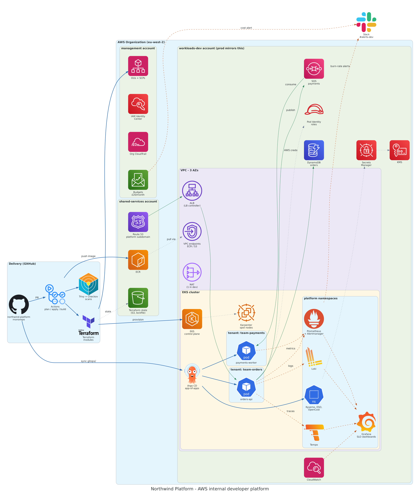

# Northwind Platform

**An AWS internal developer platform where a new product team onboards with one pull request.**
Multi-account AWS, Terraform, EKS, Argo CD GitOps, keyless CI/CD and SLO-based alerting,
validated with five incident drills.

> 🚧 **Status:** Week 0 — workspace set up. See the [roadmap](#roadmap) for progress.



<sub>Diagram generated from code: [`docs/diagrams/architecture.py`](docs/diagrams/architecture.py) · `make diagram`</sub>

---

## The scenario

Northwind Logistics (fictional) has about 80 staff and 35 engineers in 5 product teams.
Teams used to file tickets for infrastructure. This platform replaces those tickets with
self-service golden paths, so teams ship safely without waiting on a platform engineer.

**Platform promises to its users**

- **Onboard in one PR** — add `teams/<team>.yaml` and get a namespace, RBAC, quotas, network policy, ECR repo, IAM role and Argo CD project.
- **Ship safely** — every commit is tested, scanned, and deployed by GitOps; promotion to prod is a reviewed PR.
- **See everything** — metrics, logs, traces, a dashboard and an SLO for every service by default.
- **Know the cost** — per-team cost visibility and a monthly budget alarm.

---

## What this demonstrates

| Skill | Where to look |
| --- | --- |
| AWS core: VPC, IAM, EKS, DynamoDB, SQS, KMS, Route 53 | [`terraform/modules/`](terraform/modules/), [`terraform/envs/`](terraform/envs/) |
| Infrastructure as Code (Terraform) | Modules, S3 remote state with locking, env split, pinned versions |
| Multi-account governance | [`terraform/org/`](terraform/org/) — Organizations, SCPs, CloudTrail, budgets |
| Kubernetes on EKS | Karpenter (spot), LB controller, Pod Identity |
| CI/CD (GitHub Actions) | [`.github/workflows/`](.github/workflows/) — OIDC, plan on PR, apply on merge |
| GitOps (Argo CD) | [`gitops/`](gitops/) — app-of-apps, promotion by PR, rollback by `git revert` |
| Self-service platform | [`teams/`](teams/) + [`terraform/modules/tenant/`](terraform/modules/tenant/) |
| Observability and SLOs | Prometheus, Grafana, Loki, Tempo, OpenTelemetry; burn-rate alerts to Slack |
| Security by design | SCPs, least privilege, Kyverno, External Secrets, Trivy, Checkov, gitleaks |
| FinOps | Tag policy, Infracost on PRs, OpenCost per team, spot, `make down` teardown verifier |
| Python | [`apps/`](apps/) (FastAPI) and [`tools/`](tools/) with pytest |
| Operations | [ADRs](docs/adr/), [runbooks](docs/runbooks/), [postmortems](docs/postmortems/) |

---

## Demo and evidence

<!-- Replace with real captures from docs/evidence/ as milestones land. -->

| | |
| --- | --- |
| 🎬 **Demo video** (2–3 min): `make up` → deploy → drill → alert | _coming in Week 6_ |
| Grafana SLO dashboard during drill 1 | _Week 5_ |
| Slack burn-rate alert with runbook link | _Week 5_ |
| Argo CD application tree | _Week 3_ |
| PR with Terraform plan, Checkov and Infracost comments | _Week 1_ |

All screenshots live in [`docs/evidence/`](docs/evidence/).

---

## Architecture at a glance

| Layer | Built with | Lifecycle |
| --- | --- | --- |
| AWS Organization — `management`, `shared-services`, `workloads-dev`, `workloads-prod` | Terraform | Persistent |
| Shared services — ECR, Terraform state, Route 53 subdomain | Terraform | Persistent |
| Network — VPC, 3 AZs, NAT, VPC endpoints | Terraform | Per session |
| EKS cluster — Karpenter, LB controller, Pod Identity | Terraform | Per session |
| Platform services — monitoring, logging, tracing, policy, secrets, cost | Argo CD | Per session |
| Tenants and workloads — `orders-api`, `payments-worker` | Argo CD | Per session |

Design detail and trade-offs: [`docs/architecture.md`](docs/architecture.md) and [`docs/adr/`](docs/adr/).

---

## Quick start

Prerequisites: an AWS Organization management account, a domain with a subdomain you can delegate,
a GitHub repo, and a Slack webhook. All tooling is pinned in the [dev container](.devcontainer/).

```bash
# 0. Open in VS Code → "Reopen in Container"
aws sso login --profile nw-management

# 1. One-off foundation (state bucket, OIDC roles, organization)
make bootstrap

# 2. Start a working session (about 20–25 min)
make up ENV=dev

# 3. Run an incident drill and watch Grafana + Slack
make drill-1

# 4. End the session — destroys network and cluster, verifies nothing is left running
make down ENV=dev
```

---

## Cost

| State | Approximate cost |
| --- | --- |
| Session running (EKS, 2–3 spot nodes, NAT, ALB) | $0.35–0.50 per hour (about £2.50–3.50 per 8-hour session) |
| Torn down (S3 state, ECR images, Route 53 zone, Secrets) | about £1–2 per month |
| Budget alarm | £20 per month |

Estimates; measured figures will replace them after Week 2.

---

## Roadmap

| Milestone | Scope | Status |
| --- | --- | --- |
| `v0.1-foundation` | Organization, SCPs, state, OIDC, Terraform CI | ⬜ |
| `v0.2-cluster` | VPC, EKS, Karpenter, DNS, `make up/down` | ⬜ |
| `v0.3-gitops` | Argo CD, platform services, tenant self-service | ⬜ |
| `v0.4-delivery` | Apps, app pipeline, Kyverno, secrets, promotion | ⬜ |
| `v0.5-observability` | Dashboards, SLOs, burn-rate alerts, runbooks | ⬜ |
| `v0.6-drills` | Five incident drills, postmortems, OpenCost, demo | ⬜ |

---

## Repository layout

```
terraform/   bootstrap/  org/  modules/{vpc,eks,tenant,dns}/  envs/{shared,dev,prod}/
gitops/      bootstrap/  platform/  tenants/  apps/
teams/       self-service entry point, one YAML per team
apps/        orders-api/  payments-worker/
tools/       Python CLIs: tag checker, cost report, teardown verifier
docs/        architecture.md  adr/  runbooks/  postmortems/  evidence/  diagrams/  interview/
.devcontainer/  pinned toolchain for VS Code / Codespaces
```

---

## Known limitations

Single region, synthetic traffic only, Slack instead of paging, and no policy-as-code gate on
Terraform beyond Checkov. Each is recorded as a conscious trade-off in [`docs/adr/`](docs/adr/).

## About

Built by **<Your Name>** ([LinkedIn](https://www.linkedin.com/in/<your-profile>)) as a hands-on portfolio project for AWS Platform Engineer roles.
AI pair-programming (Claude Code) was used for review, explanation and boilerplate; design and
core infrastructure code are my own. Conventions are in [`CLAUDE.md`](CLAUDE.md).
